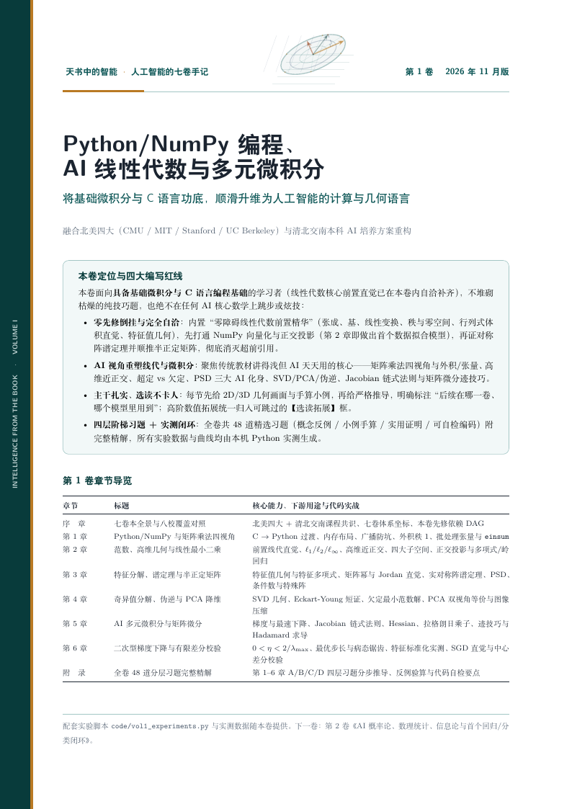
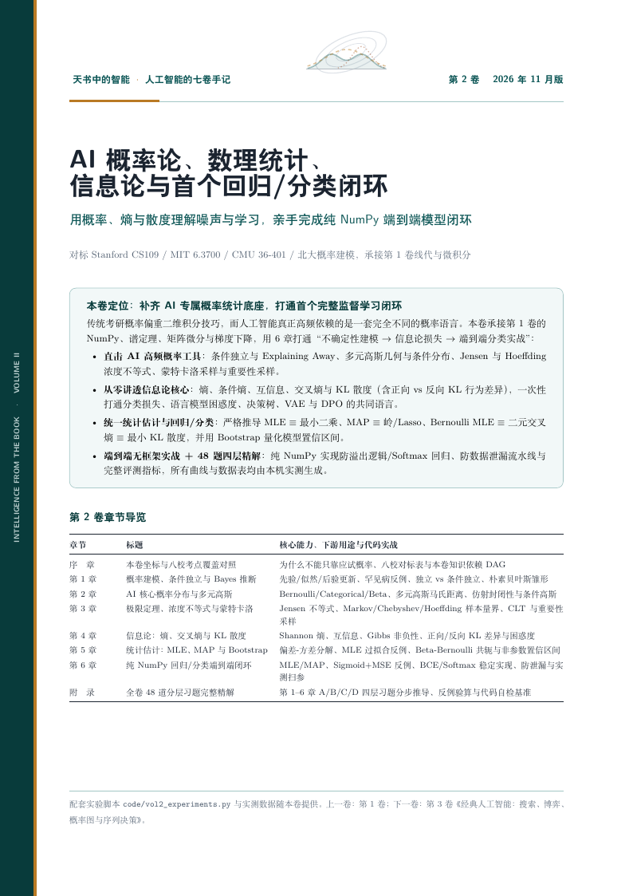
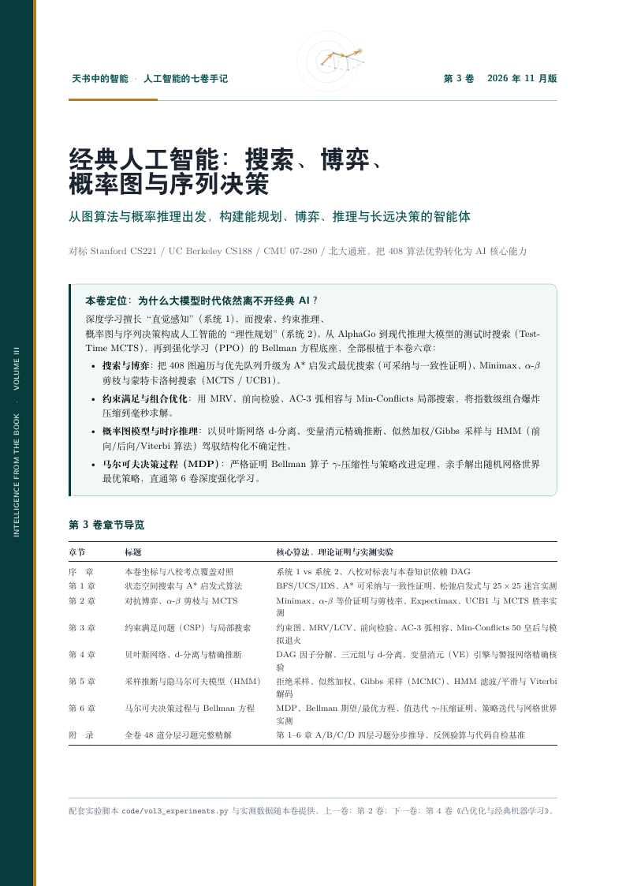
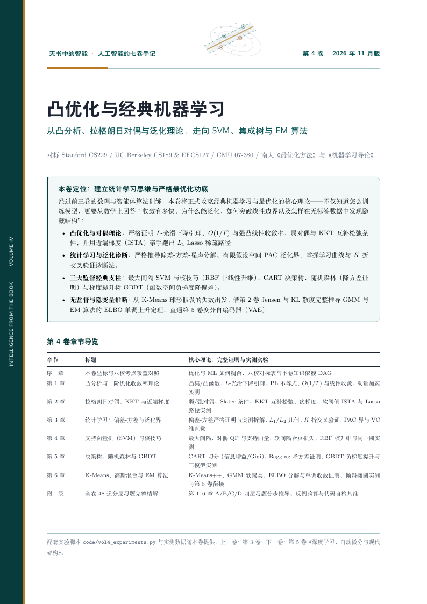
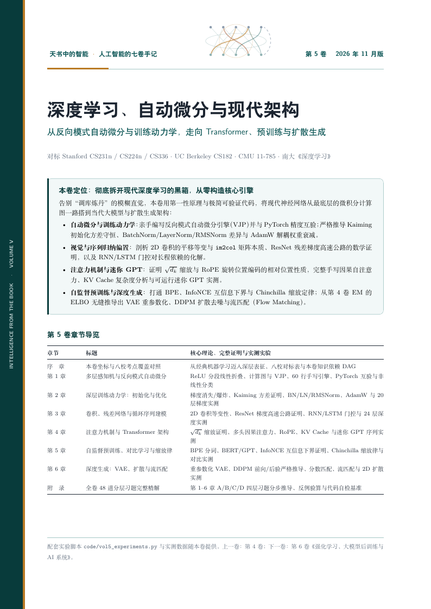
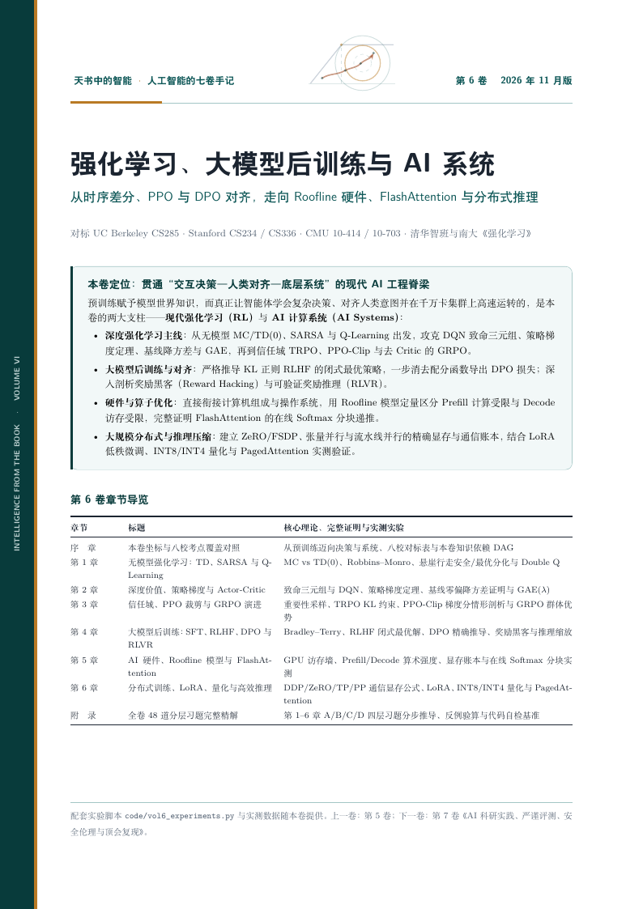
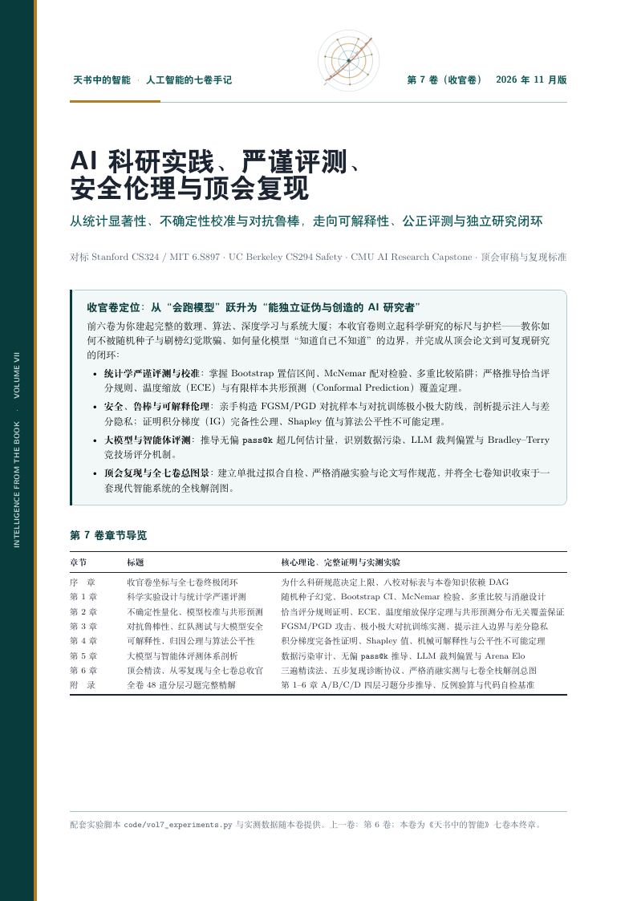

<div align="center">

# 《天书中的智能：人工智能的七卷手记》

### *Intelligence from THE BOOK · Seven Monographs on Artificial Intelligence*

> *“你不必相信上帝，但你应当相信‘天书’的存在。”*  
> —— Paul Erdős（保罗·埃尔德什，谈论记录最美证明的 *THE BOOK*）

[](#全七卷目录与直链下载)
[](#全七卷目录与直链下载)
[](#写作原则与习题体系)
[](#装帧规范与终审质量)
[](LICENSE)

**融合北美四大（CMU / MIT / Stanford / UC Berkeley）与国内顶尖高校（清华智班 / 北大通班 / 上交国智班 / 南京大学 AI）本科培养方案，从第一性原理推导与可复现代码出发，构建一套零先修倒挂的七卷本现代人工智能典藏自学专著。**

[直接下载 PDF（Releases v1.0.0）](https://github.com/uglis/intelligence-from-the-book/releases/latest) · [全七卷总目](#全七卷目录与直链下载) · [复现实验与重编 PDF](#本地复现实验与重新编译)

</div>

---

## 典藏封面巡览 · Gallery Preview

<table>
  <tr>
    <td align="center" width="25%">
      <a href="pdfs/Vol01-%E5%A4%A9%E4%B9%A6%E4%B8%AD%E7%9A%84%E6%99%BA%E8%83%BD-%E7%AC%AC1%E5%8D%B7-NumPy%E7%BA%BF%E4%BB%A3%E4%B8%8E%E5%BE%AE%E7%A7%AF%E5%88%86.pdf">
        <br/>
        <b>第 1 卷 · 94 页</b><br/>NumPy、线代与微积分
      </a>
    </td>
    <td align="center" width="25%">
      <a href="pdfs/Vol02-%E5%A4%A9%E4%B9%A6%E4%B8%AD%E7%9A%84%E6%99%BA%E8%83%BD-%E7%AC%AC2%E5%8D%B7-%E6%A6%82%E7%8E%87%E7%BB%9F%E8%AE%A1%E4%BF%A1%E6%81%AF%E8%AE%BA%E4%B8%8E%E5%9B%9E%E5%BD%92%E5%88%86%E7%B1%BB.pdf">
        <br/>
        <b>第 2 卷 · 110 页</b><br/>概率、信息论与回归分类
      </a>
    </td>
    <td align="center" width="25%">
      <a href="pdfs/Vol03-%E5%A4%A9%E4%B9%A6%E4%B8%AD%E7%9A%84%E6%99%BA%E8%83%BD-%E7%AC%AC3%E5%8D%B7-%E7%BB%8F%E5%85%B8AI%E6%90%9C%E7%B4%A2%E5%8D%9A%E5%BC%88%E5%9B%BE%E6%A8%A1%E5%9E%8B%E4%B8%8EMDP.pdf">
        <br/>
        <b>第 3 卷 · 101 页</b><br/>搜索、博弈、图模型与 MDP
      </a>
    </td>
    <td align="center" width="25%">
      <a href="pdfs/Vol04-%E5%A4%A9%E4%B9%A6%E4%B8%AD%E7%9A%84%E6%99%BA%E8%83%BD-%E7%AC%AC4%E5%8D%B7-%E5%87%B8%E4%BC%98%E5%8C%96%E4%B8%8E%E7%BB%8F%E5%85%B8%E6%9C%BA%E5%99%A8%E5%AD%A6%E4%B9%A0.pdf">
        <br/>
        <b>第 4 卷 · 102 页</b><br/>凸优化与经典机器学习
      </a>
    </td>
  </tr>
</table>

<table>
  <tr>
    <td align="center" width="33%">
      <a href="pdfs/Vol05-%E5%A4%A9%E4%B9%A6%E4%B8%AD%E7%9A%84%E6%99%BA%E8%83%BD-%E7%AC%AC5%E5%8D%B7-%E6%B7%B1%E5%BA%A6%E5%AD%A6%E4%B9%A0%E8%87%AA%E5%8A%A8%E5%BE%AE%E5%88%86%E4%B8%8E%E7%8E%B0%E4%BB%A3%E6%9E%B6%E6%9E%84.pdf">
        <br/>
        <b>第 5 卷 · 111 页</b><br/>深度学习、自动微分与现代架构
      </a>
    </td>
    <td align="center" width="33%">
      <a href="pdfs/Vol06-%E5%A4%A9%E4%B9%A6%E4%B8%AD%E7%9A%84%E6%99%BA%E8%83%BD-%E7%AC%AC6%E5%8D%B7-%E5%BC%BA%E5%8C%96%E5%AD%A6%E4%B9%A0%E5%A4%A7%E6%A8%A1%E5%9E%8B%E5%90%8E%E8%AE%AD%E7%BB%83%E4%B8%8EAI%E7%B3%BB%E7%BB%9F.pdf">
        <br/>
        <b>第 6 卷 · 121 页</b><br/>强化学习、大模型后训练与 AI 系统
      </a>
    </td>
    <td align="center" width="33%">
      <a href="pdfs/Vol07-%E5%A4%A9%E4%B9%A6%E4%B8%AD%E7%9A%84%E6%99%BA%E8%83%BD-%E7%AC%AC7%E5%8D%B7-AI%E7%A7%91%E7%A0%94%E5%AE%9E%E8%B7%B5%E8%AF%84%E6%B5%8B%E5%AE%89%E5%85%A8%E4%B8%8E%E5%A4%8D%E7%8E%B0.pdf">
        <br/>
        <b>第 7 卷 · 111 页</b><br/>科研实践、严谨评测、安全与复现
      </a>
    </td>
  </tr>
</table>

---

## 全七卷目录与直链下载

全套共 **7 卷 · 750 页 · 42 章 · 336 道分层习题与完整精解 · 42 组真实可复现实验**。

| 卷次 | 卷名与核心主线 | 页数 | PDF 成品 | LaTeX 源码 | 实验脚本 |
| :---: | :--- | :---: | :---: | :---: | :---: |
| **Vol I** | **Python/NumPy 编程、AI 线性代数与多元微积分**<br>向量化与矩阵乘法四视角、线代前置桥接、正交投影、谱定理/PSD、SVD/PCA、矩阵微积分与梯度下降动力学 | **94** | [PDF](pdfs/Vol01-%E5%A4%A9%E4%B9%A6%E4%B8%AD%E7%9A%84%E6%99%BA%E8%83%BD-%E7%AC%AC1%E5%8D%B7-NumPy%E7%BA%BF%E4%BB%A3%E4%B8%8E%E5%BE%AE%E7%A7%AF%E5%88%86.pdf) | [`volumes/vol1`](volumes/vol1) | [`vol1_experiments.py`](volumes/vol1/code/vol1_experiments.py) |
| **Vol II** | **AI 概率论、数理统计、信息论与首个回归/分类闭环**<br>条件独立与贝叶斯推断、多元高斯几何、Jensen/Hoeffding 浓度不等式、熵/KL/交叉熵、MLE/MAP、纯 NumPy 回归与分类闭环 | **110** | [PDF](pdfs/Vol02-%E5%A4%A9%E4%B9%A6%E4%B8%AD%E7%9A%84%E6%99%BA%E8%83%BD-%E7%AC%AC2%E5%8D%B7-%E6%A6%82%E7%8E%87%E7%BB%9F%E8%AE%A1%E4%BF%A1%E6%81%AF%E8%AE%BA%E4%B8%8E%E5%9B%9E%E5%BD%92%E5%88%86%E7%B1%BB.pdf) | [`volumes/vol2`](volumes/vol2) | [`vol2_experiments.py`](volumes/vol2/code/vol2_experiments.py) |
| **Vol III** | **经典人工智能：搜索、博弈、概率图与序列决策**<br>BFS/UCS/A\* 可采纳与一致性证明、Minimax/$\alpha$-$\beta$/MCTS、CSP 与 AC-3、贝叶斯网 $d$-分离与变量消元、Gibbs/HMM/Viterbi、MDP 与 Bellman 方程 | **101** | [PDF](pdfs/Vol03-%E5%A4%A9%E4%B9%A6%E4%B8%AD%E7%9A%84%E6%99%BA%E8%83%BD-%E7%AC%AC3%E5%8D%B7-%E7%BB%8F%E5%85%B8AI%E6%90%9C%E7%B4%A2%E5%8D%9A%E5%BC%88%E5%9B%BE%E6%A8%A1%E5%9E%8B%E4%B8%8EMDP.pdf) | [`volumes/vol3`](volumes/vol3) | [`vol3_experiments.py`](volumes/vol3/code/vol3_experiments.py) |
| **Vol IV** | **凸优化与经典机器学习**<br>$L$-光滑下降引理、PL 不等式与加速、拉格朗日对偶/KKT/近端 ISTA、偏差-方差与 PAC 泛化界、SVM 与核技巧、CART/随机森林/GBDT、K-Means/GMM/EM（ELBO） | **102** | [PDF](pdfs/Vol04-%E5%A4%A9%E4%B9%A6%E4%B8%AD%E7%9A%84%E6%99%BA%E8%83%BD-%E7%AC%AC4%E5%8D%B7-%E5%87%B8%E4%BC%98%E5%8C%96%E4%B8%8E%E7%BB%8F%E5%85%B8%E6%9C%BA%E5%99%A8%E5%AD%A6%E4%B9%A0.pdf) | [`volumes/vol4`](volumes/vol4) | [`vol4_experiments.py`](volumes/vol4/code/vol4_experiments.py) |
| **Vol V** | **深度学习、自动微分与现代架构**<br>MLP 与 60 行手写反向模式自动微分、Kaiming 初始化/BN/LN/RMSNorm/AdamW、CNN/ResNet/LSTM、缩放点积注意力/RoPE/KV Cache 与迷你 GPT、BPE/InfoNCE/缩放律、VAE/DDPM/流匹配 | **111** | [PDF](pdfs/Vol05-%E5%A4%A9%E4%B9%A6%E4%B8%AD%E7%9A%84%E6%99%BA%E8%83%BD-%E7%AC%AC5%E5%8D%B7-%E6%B7%B1%E5%BA%A6%E5%AD%A6%E4%B9%A0%E8%87%AA%E5%8A%A8%E5%BE%AE%E5%88%86%E4%B8%8E%E7%8E%B0%E4%BB%A3%E6%9E%B6%E6%9E%84.pdf) | [`volumes/vol5`](volumes/vol5) | [`vol5_experiments.py`](volumes/vol5/code/vol5_experiments.py) |
| **Vol VI** | **强化学习、大模型后训练与 AI 系统**<br>MC/TD(0)/SARSA/Q-Learning、DQN/策略梯度/基线降方差/GAE、TRPO/PPO-Clip/GRPO、SFT/RLHF/DPO/RLVR、GPU 内存墙/Roofline/FlashAttention 在线 Softmax、3D 并行/LoRA/INT4 量化/PagedAttention | **121** | [PDF](pdfs/Vol06-%E5%A4%A9%E4%B9%A6%E4%B8%AD%E7%9A%84%E6%99%BA%E8%83%BD-%E7%AC%AC6%E5%8D%B7-%E5%BC%BA%E5%8C%96%E5%AD%A6%E4%B9%A0%E5%A4%A7%E6%A8%A1%E5%9E%8B%E5%90%8E%E8%AE%AD%E7%BB%83%E4%B8%8EAI%E7%B3%BB%E7%BB%9F.pdf) | [`volumes/vol6`](volumes/vol6) | [`vol6_experiments.py`](volumes/vol6/code/vol6_experiments.py) |
| **Vol VII** | **AI 科研实践、严谨评测、安全伦理与顶会复现**<br>种子挑优幻觉/Bootstrap CI/McNemar 检验、温度缩放/ECE/共形预测覆盖定理、FGSM/PGD/提示注入/差分隐私、积分梯度/Shapley/公平性不可能定理、无偏 `pass@k`/Arena Elo、五步复现协议与七卷全栈总图 | **111** | [PDF](pdfs/Vol07-%E5%A4%A9%E4%B9%A6%E4%B8%AD%E7%9A%84%E6%99%BA%E8%83%BD-%E7%AC%AC7%E5%8D%B7-AI%E7%A7%91%E7%A0%94%E5%AE%9E%E8%B7%B5%E8%AF%84%E6%B5%8B%E5%AE%89%E5%85%A8%E4%B8%8E%E5%A4%8D%E7%8E%B0.pdf) | [`volumes/vol7`](volumes/vol7) | [`vol7_experiments.py`](volumes/vol7/code/vol7_experiments.py) |

---

## 写作原则与习题体系

1. **零先修倒挂**：每一卷严格遵循有向无环知识阶梯（DAG），先给具体 2D/3D 小例与失效反例建立直觉，再给完整数学推导与可运行代码；高阶拓展统一归入可跳过的紫色【选读拓展】框。
2. **四层习题与全量数值验算**：每章精选 **8 道分层习题**（全套 **336 题**），均附独立 Python/NumPy/PyTorch 验算的附录 A 完整精解：
   - **A 类（2 题）**：概念辨析、反例构造与代码排错；
   - **B 类（2 题）**：小规模模型手算演练；
   - **C 类（2 题）**：对下游真正有用的核心定理与推论证明（附【提示】）；
   - **D 类（2 题）**：带明确数值断言阈值的编程自检实验。
3. **诚实的覆盖边界**：本套书旨在无断点缝合 12–15 门顶尖高校 AI 课程约 **80%–85% 的核心理论骨架与算法灵魂**，帮助你零断层进入任何前沿课程或论文阅读；若需在单一方向（如千行级 GPU 系统开发、离线 RL 或半定规划）继续深潜，建议在读完对应卷次后衔接相应名校大作业（如 Stanford CS336 / Berkeley CS285 / CMU 10-414）与顶会完整复现。

---

## 装帧规范与终审质量

- **统一典藏版式**：全七卷共享 `11mm` 深青灰建筑书脊、烫金细线、`INTELLIGENCE FROM THE BOOK · VOLUME I–VII` 竖排铭文、七幅专属封面几何艺术画与 49 段真实可查的名家卷首题记。
- **零瑕疵视觉终审**：全部 750 页均在 **140 dpi** 下完成逐图视觉审查（覆盖 **124 幅 TikZ 图**与 **52 个 `pgfplots` 坐标轴**），七卷末遍 XeLaTeX 日志均达成 **0 编译错误、0 未定义引用、0 缺失字符、0 横纵向溢出、0 页眉警告**，全部实验数据均由真实脚本生成。

---

## 本地复现实验与重新编译

### 1. 复现全部实测实验与 CSV 数据

依赖：`python3`、`numpy`（第 5–7 卷另需 `torch`）。

```bash
# 运行全部 7 卷实验脚本
./scripts/run_all_experiments.sh

# 或仅运行指定卷次（例如第 4 卷与第 6 卷）
./scripts/run_all_experiments.sh vol4 vol6
```

### 2. 重新编译 PDF

依赖：TeX Live（需包含 `xelatex`、`ctex`、Fandol 字体、`tcolorbox`、`tikz`、`pgfplots`）。

```bash
# 双遍编译全部 7 卷并更新 pdfs/
./scripts/build_all.sh

# 或仅编译指定卷次
./scripts/build_all.sh vol5
```

---

## 目录结构

```text
intelligence-from-the-book/
├── README.md
├── LICENSE
├── assets/covers/         # 七卷封面高清缩略图
├── pdfs/                  # 七卷 140 dpi 视觉终审版 PDF（共 750 页）
├── scripts/               # 一键编译与一键复现实验脚本
└── volumes/
    ├── vol1/ ... vol7/    # 每卷完整的 LaTeX 源码、Python 实验脚本与实测 CSV
```

---

## License

本项目采用 [MIT License](LICENSE) 开源，欢迎学习、分享、二次排版与提交 Issue / PR 纠错。
